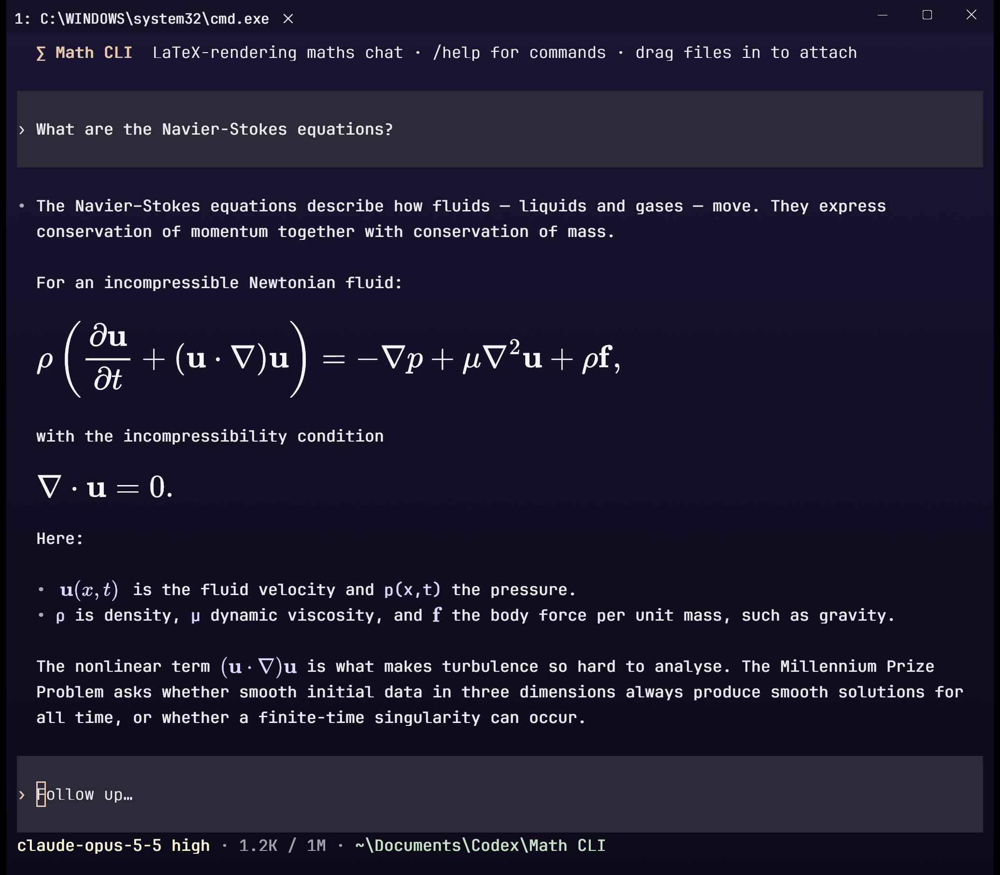
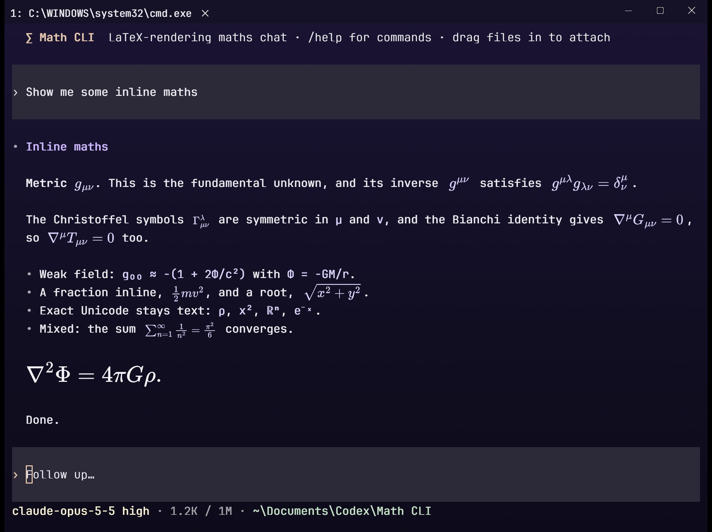
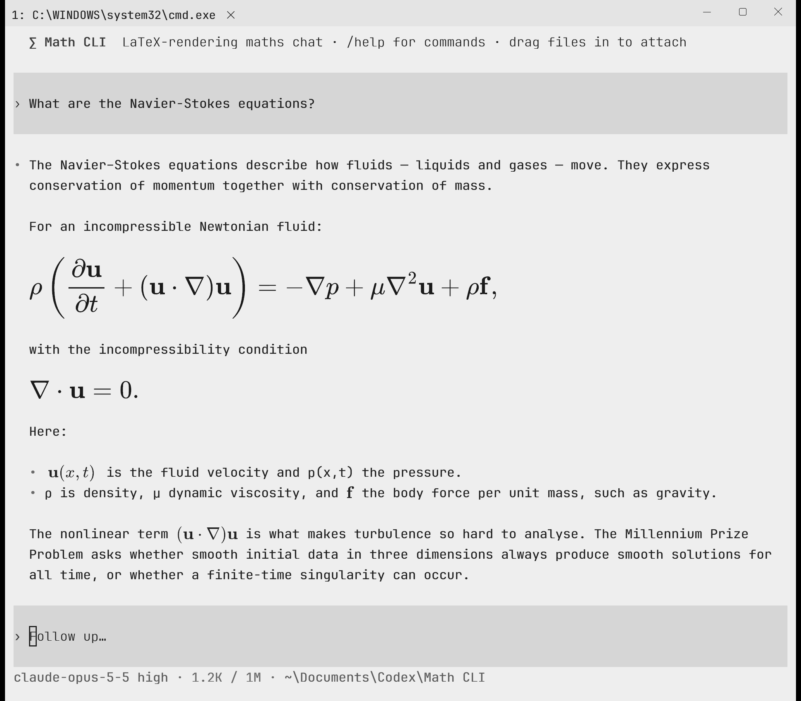
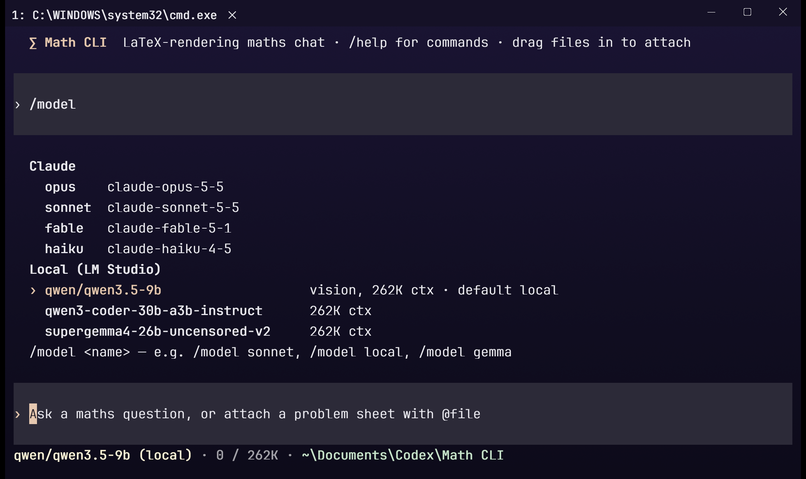

# Math CLI

**A maths chat for the terminal that renders LaTeX as real typeset equations.** Ask Claude, or a local model
running in LM Studio, a university-level question. The answer streams in with properly typeset equations
instead of raw `\frac{}{}`, and you can attach problem sheets as photos or PDFs.



> Inspired by [this post from @haskallcurry](https://x.com/haskallcurry/status/2081824968757715087), which showed
> typeset maths rendered inside a coding-agent CLI. Math CLI applies the same idea to a dedicated maths assistant.

## Features

- **Typeset display maths.** `$$…$$` is rendered by MathJax and drawn as an image sized to your terminal
  font, in the theme's ink colour.
- **Inline maths that fits the line.** Short expressions stay as Unicode text when that's exact (ρ, x², ℝⁿ).
  Anything Unicode can't show, such as g_{μν}, fractions and roots, is typeset as a one-line image on the text baseline.
- **Claude or local models.** Opus / Sonnet / Fable / Haiku through the Anthropic API, or any LM Studio model
  (no API key, nothing leaves your machine). Switch mid-conversation with `/model`.
- **Attachments.** Drag in, paste (Ctrl+V) or `@`-mention images, screenshots, PDFs and `.tex` files.
- **Context meter.** The status line shows how much of the model's context window the chat uses.
- **Themes and transparency.** Royal (dark purple), white, midnight and mocha themes, or your own. In WezTerm,
  each theme also sets the window background, opacity and acrylic blur.
- **Tidy exit.** Closing the window unloads the local model and shuts LM Studio down again.

| Inline maths | White theme | Local models |
|---|---|---|
|  |  |  |

Built and tested on Windows 11 with WezTerm. The Kitty/iTerm2 image paths are implemented but untested on
macOS and Linux.

## Setup

Requires Node 22+ and a terminal with inline images — **WezTerm** (recommended on Windows),
iTerm2, Kitty or Ghostty. Other terminals fall back to Unicode-only maths.

```
npm install
npm link        # optional: adds a global `mathcli` command
```

### WezTerm on Windows

1. **Install WezTerm:** `winget install wez.wezterm`
2. **Update its ConPTY (required).** WezTerm's latest release (Feb 2024) bundles an old ConPTY that
   misplaces equation images after the window is resized. Close every WezTerm window, open
   **PowerShell as administrator** in this folder and run:

   ```
   powershell -ExecutionPolicy Bypass -File scripts\update-wezterm-conpty.ps1
   ```

   It downloads Microsoft's current ConPTY from nuget.org, checks the package against a pinned SHA-512
   and both files for a valid Microsoft signature, then swaps them into `C:\Program Files\WezTerm`
   (originals kept as `*.bak`). **Re-run it after reinstalling or upgrading WezTerm.**
3. **Let Math CLI theme its window (optional).** Run `/setup-terminal` inside `mathcli` once. It adds one
   line to your `.wezterm.lua` (backup saved as `.wezterm.lua.bak`) so the app can set that window's
   background, transparency and blur while it runs. Other WezTerm windows are unaffected.

## API key

You need an Anthropic API key: <https://console.anthropic.com/settings/keys>. Any of these works
(first match wins):

1. **Environment variable** — `ANTHROPIC_API_KEY`. Per session in PowerShell:
   `$env:ANTHROPIC_API_KEY = "sk-ant-…"`; permanently: `setx ANTHROPIC_API_KEY "sk-ant-…"` (then open a new terminal).
2. **Saved config** — just run `mathcli`; with no key it asks you to paste one, checks it, and saves it to
   `%USERPROFILE%\.mathcli\config.json`.
3. **Replace later** — `/key` inside the app.

The config file stores the key in plain text, readable by your user account only.

## Usage

```
mathcli              # or: npm start
```

- **Paste** with **Ctrl+V** (text, a copied screenshot, or files copied in Explorer — images/files become attachments). WezTerm's own paste, Ctrl+Shift+V, also works for text.
- Type a question and press **Enter**. **Ctrl+J** or `\` + Enter adds a new line; **↑/↓** recalls history.
- **Attach files** (images, PDFs, `.tex`/`.txt`): drag them onto the WezTerm window, type `@path\to\file.pdf`
  in your message (quote paths with spaces: `@"C:\My Notes\sheet 3.pdf"`), or use `/attach`.
- **Ctrl+C** stops an answer mid-stream; on an empty prompt it quits.

| Command | |
|---|---|
| `/model [name]` | list or switch models: `opus`, `sonnet`, `fable`, `haiku`, `local`, or an LM Studio model by name (e.g. `/model gemma`) |
| `/effort [low…max]` | reasoning depth (default `high`) |
| `/thinking` | show Claude's summarised reasoning |
| `/scale <n>` | display-math size relative to text (default 1.5) |
| `/inline [auto\|image\|unicode]` | inline maths: `auto` keeps exact Unicode (ρ, x², ℝⁿ) as text and typesets the rest (g_{μν}, fractions) as one-line images |
| `/theme [name]` | list or switch themes |
| `/opacity [0.3–1]` | window transparency (WezTerm, after `/setup-terminal`) |
| `/blur [on\|off]` | acrylic blur behind a translucent window (Windows 11) |
| `/copy`, `/copy-latex` | copy the last answer / its equations |
| `/attach`, `/detach` | manage attachments |
| `/redraw` | re-render the conversation (e.g. after resizing the window) |
| `/clear` | new conversation |
| `/key` | replace the API key |
| `/setup-terminal` | enable WezTerm window theming (see Setup) |

Settings changed with commands persist in `%USERPROFILE%\.mathcli\config.json`.

## Local models (LM Studio)

Any model downloaded in [LM Studio](https://lmstudio.ai) can answer instead of Claude — no API key, no
cost, nothing leaves your machine. `/model` lists them with their capabilities; `/model local` picks the
default local model (`qwen/qwen3.5-9b`) and `/model gemma` matches by name. The conversation carries
over when you switch, in either direction.

- **Server:** Math CLI starts LM Studio's local server (`lms server start`) if it isn't running. Models
  load on the first message (a few seconds) and unload after LM Studio's idle timeout.
- **Images** go to vision models (marked `vision` in `/model`, e.g. Qwen3.5-9B); text-only models skip them with a note.
- **PDFs** are sent as their extracted text. Scanned PDFs have no text layer — use Claude for those.
- **Context:** LM Studio loads models with a 32K context by default. Raise it per model in
  LM Studio → My Models → ⚙ → Context Length.
- **Server address:** `lmstudioUrl` in `config.json` (default `http://localhost:1234`).
- **On exit** — quitting, or just closing the WezTerm window — Math CLI frees the GPU memory again.
  `/local-exit` sets how far it goes:
  - `auto` (default): unload the models this session loaded; stop the server and quit LM Studio only if
    Math CLI started them (an LM Studio you opened yourself is left running).
  - `always`: unload everything, stop the server and quit LM Studio.
  - `keep`: leave LM Studio and the loaded model as they are (faster to resume).

  The cleanup runs as a separate background process so it survives the window closing; it logs to
  `%USERPROFILE%\.mathcli\cleanup.log`.

The status line shows a **context meter** for every model (e.g. `1.7K / 33K`): how much of the context
window the conversation fills. It turns red past 80%; `/clear` starts fresh.

## Themes

Built-in: **royal** (default — glossy dark royal purple with a subtle gradient), **white** (light grey,
near-monochrome, Grok CLI style), **midnight** (slate blue), **mocha** (Catppuccin Mocha). `/theme` shows swatches; `/theme mocha` switches live and redraws the conversation (boxes and equations) in the new colours.

Translucency: `/opacity 0.88` makes the window glass-like; with `/blur on` (default) Windows 11 frosts
whatever is behind it. `/opacity 1` turns it off.

Custom themes are JSON files in `%USERPROFILE%\.mathcli\themes\<name>.json`. List only the colours you
want to change; the rest come from `base`:

```json
{
  "base": "royal",
  "gradient": ["#24123d", "#120b22", "#08060f"],
  "accent": "#ffb86c",
  "heading": "#bd93f9",
  "displayMath": "#ffffff"
}
```

Fields: `background`, `gradient` (top→bottom), `foreground`, `titlebar`, `cursor`, `selection`, `panel`,
`accent`, `heading`, `bullet`, `code`, `codeBlock`, `quote`, `error`, `thinking`, `attach`,
`statusModel`, `statusPath`, `dim`, `displayMath`, `inlineMath`.

## Development

```
npm test             # streaming renderer tests
npm run typecheck
npm run spike        # static rendering demo, no API calls
npm run render       # write sample equations to PNGs
```

## Troubleshooting

**Equations jump to the right edge after resizing the window (Windows).** WezTerm's bundled ConPTY is
out of date — run `scripts\update-wezterm-conpty.ps1` as described in Setup step 2.

**Theme background or transparency doesn't change.** Run `/setup-terminal`, then restart `mathcli`.
Check that `.wezterm.lua` contains the `.mathcli/wezterm.lua` line.

## Licence

MIT — see [LICENSE](LICENSE).
